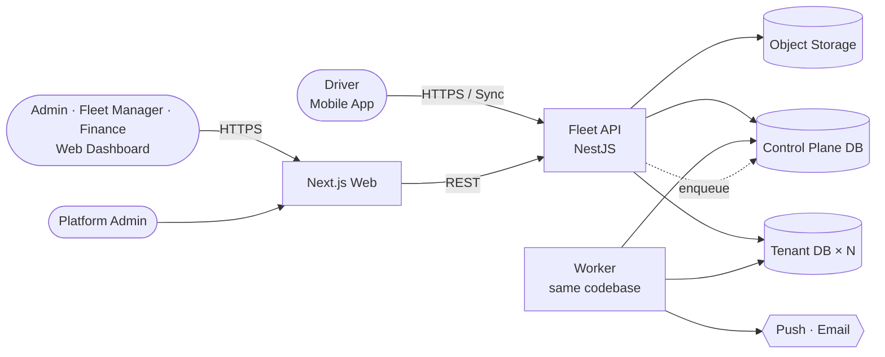
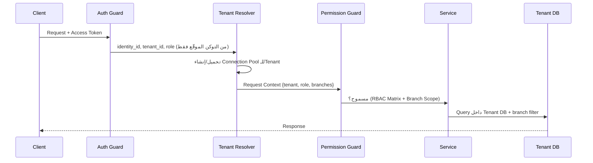
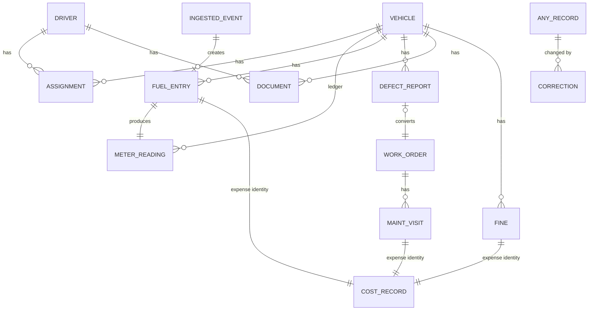
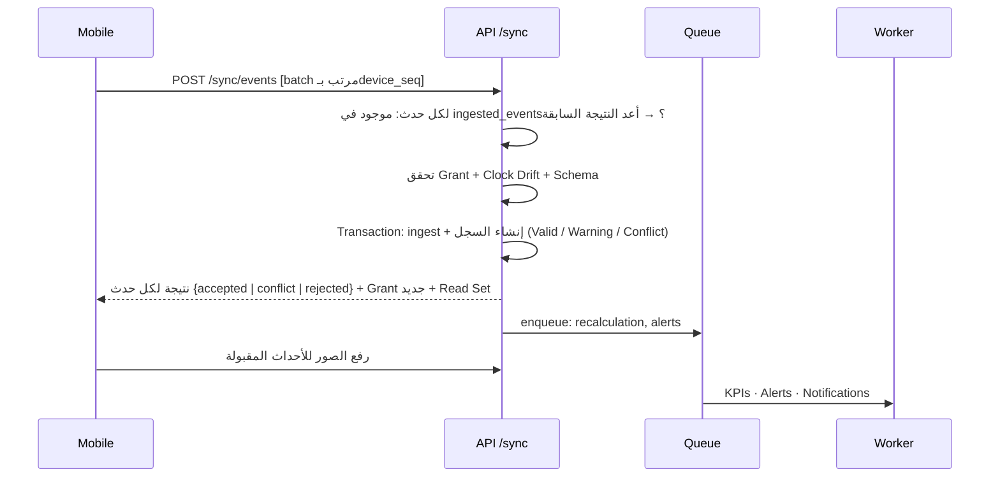

# Architecture Design Document
## Fleet Management SaaS Platform

**Version:** 0.1 — Proposed Baseline · **Date:** 11 Nov 2026
**Inputs:** `PRD_v0.3.md` · `Country_Profile_Egypt.md` · `Backlog_Epics_Stories_v0.3.md`
**Context:** منفّذ واحد يبني بأدوات AI · Pilot ~100 مركبة في مصر · Multi-Tenant / Region-Ready لاحقًا
**Status:** قرارات الـStack اتُخذت بالتفويض — قابلة للمراجعة قبل بدء الكود

---

## 1. Architecture Drivers

| Driver | Source | أثره على التصميم |
|---|---|---|
| منفّذ واحد + AI | قرار المالك | لغة واحدة، Deployable واحد، أقل عدد ممكن من الخدمات المُدارة يدويًا |
| Database per Tenant | PRD §6 (Confirmed) | Control Plane DB + Tenant DBs، Tenant Routing، Migrations لكل Tenant |
| Offline-First للسائق | OFF-001..013 | Outbox على الجهاز، Sync Idempotent، Offline Grant موقّع |
| سلامة مالية وبيانات | GEN-001..012 | Append-only Ledgers، Corrections، Expense Identity بقيد Unique |
| نفس القواعد على السيرفر والموبايل | OPS, FUEL, ODO | Domain Package مشترك (Validation + Calculations + Readiness) |
| Region-Ready وOD-06 غير محسوم | PRD §34 | كل شيء في Containers + PostgreSQL + S3-compatible؛ لا اعتماد على خدمة خاصة بمزود |
| حجم صغير (≤ 600 حدث/يوم) | Country Profile §9 | Modular Monolith؛ لا Microservices، لا Kafka، لا Redis في البداية |
| أجهزة Android ضعيفة | NFR-011 | تطبيق خفيف، SQLite محلي، ضغط صور على الجهاز |

**المبدأ الحاكم:** أبسط معمارية تحقق متطلبات الـPilot دون قرار يمنع التوسع لاحقًا.

---

## 2. Technology Stack (Decided)

| Layer | Choice | Why |
|---|---|---|
| Language | **TypeScript** في كل الطبقات | لغة واحدة لمنفّذ واحد؛ مشاركة الأنواع والقواعد |
| Monorepo | pnpm workspaces + Turborepo | كود مشترك بين API/Web/Mobile |
| Backend API | **NestJS** (Modular Monolith) | بنية Modules واضحة تطابق موديولات الـPRD؛ Guards للـRBAC |
| Database | **PostgreSQL 16** (Self-managed على Hetzner) | لا يوجد Managed PostgreSQL على Hetzner؛ نشغّله بأنفسنا مع WAL-G للـPITR؛ قيود Integrity قوية |
| DB Access | Drizzle ORM + SQL Migrations | اتصالات ديناميكية لكل Tenant بسهولة؛ SQL صريح |
| Background Jobs | **pg-boss** (Queue على PostgreSQL) | بدون Redis؛ خدمة أقل للتشغيل |
| API Contract | REST + Zod Schemas + OpenAPI (ts-rest) | عقد واحد يولّد Client مكتوب الأنواع للـWeb والموبايل |
| Web | **Next.js** (واجهة فقط) + Tailwind + shadcn/ui + next-intl | RTL/i18n جاهز؛ لا Business Logic في Next |
| Mobile | **React Native (Expo)** + expo-sqlite | يشارك Domain Package؛ Camera/Offline/Push مدعومة |
| File Storage | S3-compatible Object Storage | Presigned URLs؛ ينتقل لأي مزود (أو MinIO محليًا) |
| Auth | Module داخلي بمكتبات مُثبتة (argon2, otplib, jose) | Activation Codes + TOTP + Device Binding + Offline Grant لا يغطيها مزود جاهز مع قيود الإقامة |
| Notifications | **Email + Mobile App فقط:** Push عبر FCM/APNs (Expo) + In-App · Email عبر SMTP Provider — خلف Notification Port | قرار المالك: لا SMS ولا WhatsApp؛ تبديل مزود البريد بدون تغيير الكود |
| Observability | OpenTelemetry + Sentry + Structured Logs (بـtenant_id) | تشخيص لكل Tenant (NFR-008) |
| CI/CD | GitHub Actions → Docker Images | نفس الـImage لكل البيئات |
| Testing | Vitest · Testcontainers (PostgreSQL) · Playwright · Maestro | انظر §12 |

---

## 3. System Context



- **Deployables:** `api` و`worker` (نفس الكود، Entry Point مختلف) + `web`. الموبايل يُنشر عبر المتاجر.
- **Pilot Footprint (Hetzner):** سيرفر تطبيق واحد (api + worker + web + Caddy) + سيرفر قاعدة بيانات منفصل يحمل Control Plane DB وTenant DB (قواعد بيانات منفصلة على نفس الـServer؛ يتحقق Database per Tenant دون تكلفة Server لكل عميل) + Hetzner Object Storage.

---

## 4. Repository Layout

```
fleet-management-system/
├─ apps/
│  ├─ api/            NestJS: HTTP + Sync endpoints
│  ├─ worker/         pg-boss consumers: KPIs, alerts, notifications, imports
│  ├─ web/            Next.js dashboard
│  └─ mobile/         Expo driver app
├─ packages/
│  ├─ domain/         Pure TS: validation rules, calculations, readiness engine, state machines
│  ├─ contracts/      Zod schemas + ts-rest API contract + generated OpenAPI
│  ├─ db/             Drizzle schemas (control + tenant), migrations, tenant migration runner
│  ├─ i18n/           ar/en message catalogs
│  └─ config/         D-* defaults, country templates (Egypt), RBAC matrix as data
├─ docs/              PRD, Gap Analysis, Country Profile, Architecture, ADRs
└─ infra/             Dockerfiles, docker-compose (local), deployment manifests
```

**القاعدة الأهم:** `packages/domain` لا يعتمد على قاعدة بيانات أو شبكة أو وقت النظام (الوقت يُمرَّر كمُدخل). هذا يجعله قابلًا للتشغيل على الموبايل Offline وللاختبار بالـWorked Examples مباشرة.

---

## 5. Backend Module Map

| Nest Module | PRD Prefix | Owns |
|---|---|---|
| `platform` | TEN, CTR | Tenants، Provisioning، Country Templates، Fuel Price Table، Break-Glass |
| `identity` | SEC | Login، Activation Codes، MFA، Tokens، Devices، Offline Grants |
| `access` | SEC | Roles، Memberships، Permission Guard، Branch Scoping |
| `org` | ADM, VND | Company، Branches، Cost Centers، Vendors |
| `fleet` | VEH, DRV, ASN | Vehicles، Drivers، Assignments، Handover، Custody Timeline |
| `meter` | ODO | Meter Readings Ledger، Validation، Replacement |
| `fuel` | FUEL | Fuel Entries، Cycles، Budgets |
| `maintenance` | MNT, WO | Templates، Defects، Work Orders، Visits، Forecast |
| `documents` | DOC | Types، Records، Verification، File Links |
| `readiness` | OPS | Rule Catalog، Evaluation، Overrides |
| `finance` | FIN, INC(Fines) | Cost Records، Tax Treatment، Fines |
| `alerts` | ALR, NTF | Alert Catalog، Lifecycle، Notification Dispatch |
| `sync` | OFF | Event Ingestion، Idempotency، Conflict Queue |
| `corrections` | AUD | Corrections، Approvals، Recalculation Triggers |
| `analytics` | KPI, RPT | KPI Snapshots، Dashboards، Reports، Export |
| `imports` | IMP | Batches، Mapping، Validation، Rollback |
| `audit` | SEC-011 | Append-only Audit Log |
| `files` | — | Presigned Upload/Download، Virus/Type Checks |

**قواعد الاعتمادية:** الموديولات تتواصل عبر Service Interfaces وDomain Events داخل العملية (in-process)، ولا يقرأ موديول جداول موديول آخر مباشرة. هذا يُبقي خيار فصل موديول لخدمة مستقلة مفتوحًا دون تنفيذه الآن.

---

## 6. Multi-Tenancy Design

### 6.1 Control Plane vs Tenant Data

| Control Plane DB (واحدة) | Tenant DB (واحدة لكل شركة) |
|---|---|
| tenants، tenant_db_location، regions | كل البيانات التشغيلية والمالية |
| identities، credentials، devices، memberships | roles/permissions الخاصة بالشركة |
| country_templates، fuel_price_table | company settings (effective-dated) |
| platform_audit، break_glass_grants | audit_log، corrections |
| job queue (pg-boss)، subscriptions | kpi_snapshots، alerts |

### 6.2 Request Flow



- **Tenant ID لا يُقبل من Body/Query/Header العميل** (TEN-002)؛ المصدر الوحيد هو التوكن.
- **Connection Pools:** Cache بحد أقصى (LRU) لكل Tenant؛ عند تزايد العملاء يُضاف PgBouncer.
- **Branch Scoping:** يُفرض في طبقة Repository مشتركة (كل Query على كيان له `branch_id` يمر عبر Scope إجباري)، وليس في الـControllers.
- **Object Storage:** Prefix/Bucket لكل Tenant + مفتاح تشفير لكل Tenant؛ الوصول بـPresigned URL قصير العمر يصدره الـAPI بعد فحص الصلاحية.

### 6.3 Provisioning & Migrations

- **Provisioning (TEN-001):** Job واحد Idempotent بخطوات مسجلة: Create DB → Run Migrations → Seed (Roles, Country Template) → Create Storage Prefix → Invite Admin → Mark Active. فشل أي خطوة يُبقي الحالة `Provisioning/Failed` وغير قابلة للدخول.
- **Migrations (TEN-006):** Runner يمر على كل Tenant، يسجل الإصدار والنتيجة في Control Plane. التغييرات **Expand → Migrate → Contract** (متوافقة للخلف) حتى يعمل الكود الجديد مع Tenants لم تُرقَّ بعد.

---

## 7. Data Design Principles

| Principle | Implementation |
|---|---|
| IDs | UUIDv7 (مرتبة زمنيًا، تُولَّد على الجهاز Offline) |
| Time | `event_at timestamptz` + `event_tz` + `recorded_at`؛ لا استخدام لوقت الجهاز كوقت استلام |
| Money | عدد صحيح بالوحدة الصغرى (قروش) + `currency`؛ `net`/`tax`/`gross` منفصلة |
| Quantities | `numeric(10,3)` للترات/m³؛ العداد عدد صحيح بالكيلومتر |
| No Hard Delete | لا `DELETE` في صلاحيات مستخدم التطبيق على الجداول التشغيلية؛ `voided_at/void_reason` |
| No Silent Overwrite | تعديل السجل المعتمد يمر فقط عبر `corrections`؛ جدول history بـTrigger كشبكة أمان |
| Expense Identity | `cost_records` عليه `UNIQUE(source_type, source_id)` → التكرار المالي مستحيل على مستوى القاعدة |
| Idempotent Ingest | `ingested_events(event_id PK)` → إعادة الإرسال تُرجع النتيجة السابقة |
| Effective-dating | جداول الإعداد بـ`valid_from/valid_to` مع قيد عدم التداخل (exclusion constraint) |
| Assignments | Exclusion Constraint يمنع تداخل Primary على نفس المركبة (ASN-002) على مستوى القاعدة |
| Audit | جدول Append-only؛ مستخدم التطبيق له `INSERT` فقط |
| Sensitive Fields | Envelope Encryption على مستوى الحقل (مفتاح لكل Tenant)؛ Blind Index للبحث بالرقم القومي |

### 7.1 Core Ledgers



---

## 8. Offline & Sync Design

### 8.1 On the Device

- **Local Store:** SQLite مشفّر: `outbox` (أحداث معلقة)، `read_set` (المركبة، آخر عداد، المستندات، الصيانة المستحقة)، `offline_grant`.
- **Outbox Event:** `{event_id (UUIDv7), type, payload, device_id, device_seq, device_time, clock_offset, grant_id}`.
- **Photos:** تُضغط على الجهاز (≤ 500 KB)، تُحفظ كملفات، وتُرفع **بعد** قبول الحدث النصي عبر Presigned Upload قابل للاستكمال.
- **Validation:** نفس `packages/domain` يعمل محليًا لإظهار التحذيرات فورًا؛ القرار النهائي للسيرفر.

### 8.2 Offline Grant (OFF-002)

توكن موقّع (JWS) يصدره السيرفر عند كل اتصال ناجح:
`{driver, tenant, device, assignments[], readiness_snapshot, issued_at, expires_at = +72h}`.

- الجهاز يتحقق من التوقيع بالمفتاح العام ومن الصلاحية قبل بدء أي عملية Offline.
- لمقاومة تغيير ساعة الجهاز: يُخزَّن `server_time` و`monotonic_clock` عند الإصدار، وتُحسب المدة المنقضية من الساعة الـMonotonic لا من ساعة الحائط.
- بعد الانتهاء: منع عمليات جديدة، مع بقاء إغلاق القائم وإرسال المعلّق (OFF-003).

### 8.3 Sync Protocol



- **Ordering:** المعالجة بـ`device_seq`؛ حدث يسبق تابعه المفقود → `pending_dependency` (OFF-007).
- **Conflicts:** لا يُرفض الحدث؛ يُحفظ الأصل ويدخل `conflict_reviews` لقرار بشري (OFF-010).
- **Clock:** `drift = server_now − (device_time_at_send)`؛ أكبر من 5 دقائق أو وقت مستقبلي → Flag (OFF-006).

---

## 9. Calculation & KPI Design

- **الحسابات كدوال Pure** في `packages/domain`: `fullToFullCycles()`, `evaluateReadiness()`, `maintenanceStatus()`, `validateMeterReading()`, `costPerKm()`, `dataQuality()`.
- **KPI Snapshots:** جدول `kpi_period_snapshot(entity, period, kpi, value, quality, computed_at, inputs_hash)`.
- **Recalculation (AUD-003):** أي سجل جديد/تصحيح/حسم تعارض يكتب صفًا في `dirty_periods(entity, period)`؛ Worker يعيد الحساب ويحدّث الـSnapshot. الواجهة تعرض "Recalculating" طالما الفترة Dirty.
- **في حجم الـPilot** إعادة الحساب تستغرق ثوانٍ؛ نفس التصميم يتحمل التوسع بدون تغيير.
- **Data Quality** يُحسب مع القيمة في نفس الدالة، فلا يمكن عرض KPI بدون حالته (GEN-011).

---

## 10. Security Architecture

| Concern | Design |
|---|---|
| Web/Admin Auth | Email + Password (argon2id) + TOTP؛ Access Token 15 دقيقة + Refresh Token دوّار في HttpOnly Cookie |
| Driver Auth | Username + One-time Activation Code/QR من المدير (24 ساعة، استخدام واحد، مخزَّن Hashed) → تسجيل الجهاز بـKeypair في Secure Enclave/Keystore → Refresh Token مربوط بالجهاز؛ فتح التطبيق بـPIN/Biometric. لا SMS ولا WhatsApp |
| Authorization | `PermissionGuard(action, resource)` يقرأ RBAC Matrix من `packages/config` (بيانات لا كود) + Branch Scope في الـRepository |
| Maker ≠ Checker | فحص عام في `corrections`/`verification`: `approver_id ≠ created_by` + قيد CHECK في القاعدة |
| Tenant Isolation | قواعد بيانات منفصلة + مستخدم DB لكل Tenant + اختبار آلي يحاول الوصول العابر في كل Endpoint |
| Break-Glass | Grant في Control Plane بموافقة ومدة؛ اتصال Read-only بمستخدم DB مخصص؛ Audit في قاعدة العميل |
| Encryption | TLS 1.2+؛ تشفير Storage وDB at rest؛ Field-level للحساس |
| Secrets | Secret Manager للمزود أو متغيرات مشفرة؛ لا أسرار في الـRepo |
| Mobile | SQLite مشفّر، Certificate Pinning، لا بيانات حساسة في الـLogs، مسح الـCache عن بُعد |
| Rate Limiting | على Login/Activation/Sync لكل هوية وIP |
| Baseline | OWASP ASVS L2 / MASVS Checklist ضمن Definition of Done |

---

## 11. Deployment & Operations

| Environment | Purpose | Notes |
|---|---|---|
| Local | تطوير | docker-compose: Postgres + MinIO + Mailhog |
| Staging | اختبار وUAT | نفس Images الإنتاج؛ بيانات اختبار فقط |
| Production | Pilot | **Hetzner Cloud — Germany (Falkenstein أو Nuremberg)**؛ Private Network بين السيرفرات |

- **Hosting (OD-06 = Hetzner):** Hetzner Cloud في ألمانيا (أقرب مواقع Hetzner لمصر). التشغيل بـDocker Compose + Caddy (TLS تلقائي)، بدون Kubernetes في الـPilot. Hetzner Firewall: فقط 443 مفتوح للعامة، وSSH بالمفتاح من IPs محددة، وقاعدة البيانات على الـPrivate Network فقط. المعمارية تبقى Portable (Containers + PostgreSQL + S3)، فالنقل لمزود آخر أو داخل مصر لاحقًا لا يغيّر الكود.
- **Backups (Self-managed):** WAL-G يرسل WAL كل 60 ثانية + Base Backup يومي إلى Hetzner Object Storage في **موقع مختلف** (مثل Helsinki) ومشفّر قبل الرفع → RPO ≤ 15 دقيقة؛ Object Storage بـVersioning؛ Hetzner Server Backups/Snapshots كطبقة إضافية؛ Restore Drill ربع سنوي بـRunbook موثّق لتحقيق RTO ≤ 4 ساعات (NFR-004).
- **Releases:** GitHub Actions → Build → Tests → Image → Staging → موافقة يدوية → Production؛ Migrations تعمل قبل تحويل الترافيك.
- **Mobile Releases:** EAS Build؛ تحديثات JS عبر OTA للإصلاحات العاجلة؛ `min_supported_version` يفرضه السيرفر.
- **Monitoring:** Uptime Check خارجي، Sentry للأخطاء، لوحات: Sync Success Rate، Queue Lag، Failed Notifications، Backup Status.

---

## 12. Test Strategy

| Level | Tool | Covers |
|---|---|---|
| Domain Unit | Vitest | كل دوال `packages/domain`؛ **Worked Examples من Gap Analysis ملحق E كـGolden Tests** |
| Integration | Vitest + Testcontainers | Services مقابل PostgreSQL حقيقي؛ القيود (Unique/Exclusion)؛ Migrations |
| RBAC Matrix | مولَّد من `packages/config` | كل خلية (Role × Action) سماحًا ومنعًا عبر الـAPI (US-E02-04) |
| Tenant Isolation | Integration | كل Endpoint بهوية Tenant آخر (US-E01-02) |
| Sync | Integration | Retry، Out-of-order، Duplicate، Clock Drift، Expired Grant |
| Web E2E | Playwright | المسارات الحرجة AR/RTL وEN |
| Mobile E2E | Maestro | تفويلة Offline → Sync؛ على Android منخفض الإمكانيات |
| Acceptance | من الـBacklog | كل AC بصيغة Given/When/Then يقابله اختبار معرّف بـStory ID |

---

## 13. Architecture Decision Records

| ADR | Decision | Alternatives Rejected | Reversibility |
|---|---|---|---|
| ADR-001 | TypeScript في كل الطبقات | .NET + Flutter (ثلاث لغات لمنفّذ واحد) | صعب بعد البدء |
| ADR-002 | Modular Monolith (API + Worker) | Microservices (تعقيد تشغيلي بلا حاجة لهذا الحجم) | سهل: حدود الموديولات تسمح بالفصل |
| ADR-003 | PostgreSQL، قاعدة لكل Tenant على Server مشترك في البداية | Server لكل Tenant (تكلفة)؛ Schema-per-tenant (يخالف القرار المؤكد) | سهل: نقل قاعدة لـServer آخر |
| ADR-004 | Control Plane DB منفصلة للهوية والتوجيه | الهوية داخل Tenant DB (يمنع Cross-Tenant Identity) | متوسط |
| ADR-005 | Auth داخلي بمكتبات مُثبتة | Supabase Auth / Auth0 / Clerk (إقامة بيانات، Offline Grant وDevice Binding غير مدعومة جاهزة) · Keycloak (ثقيل لمنفّذ واحد) | متوسط: خلف `identity` module |
| ADR-006 | pg-boss للـJobs | Redis + BullMQ (خدمة إضافية) | سهل: خلف Queue Port |
| ADR-007 | Supabase + Vercel **ليست** منصة الإنتاج | — السبب: مشروع Supabase لكل Tenant، ومناطق خارج مصر. تبقى مناسبة للنماذج السريعة فقط | — |
| ADR-008 | REST + Zod Contract (ts-rest) | GraphQL (تعقيد)؛ tRPC (يصعّب API عام لاحقًا) | متوسط |
| ADR-009 | React Native (Expo) | Flutter (لا يشارك Domain Package)؛ PWA (Offline/Camera/Background أضعف) | صعب |
| ADR-010 | Outbox + Idempotent Event Ingest، بدون CRDT/Sync Engine جاهز | PowerSync/WatermelonDB Sync (تفرض نموذج Last-Write-Wins يخالف OFF-010) | متوسط |
| ADR-011 | KPI Snapshots + Dirty Periods | حساب عند كل طلب (لا يتحمل التوسع)؛ Data Warehouse (سابق لأوانه) | سهل |
| ADR-012 | قيود سلامة البيانات في القاعدة نفسها (Unique, Exclusion, Append-only grants) | الاعتماد على كود التطبيق فقط | — |
| ADR-013 | Next.js للواجهة فقط؛ كل المنطق في الـAPI | Business Logic في Server Actions (يكسر مشاركة الموبايل لنفس الـAPI) | سهل |
| ADR-014 | S3-compatible Storage بـPresigned URLs | ملفات في القاعدة؛ تخزين خاص بمزود | سهل |
| ADR-015 | Hetzner Cloud (Germany) مع PostgreSQL Self-managed وDocker Compose | Hyperscaler بقاعدة مُدارة (تكلفة أعلى كثيرًا)؛ Kubernetes (عبء تشغيلي لمنفّذ واحد) | سهل: Containers + PostgreSQL + S3 قابلة للنقل |

---

## 14. Build Sequence (يطابق PRD §33)

| Milestone | Deliverable | يثبت |
|---|---|---|
| **M0 — Walking Skeleton** | Monorepo + CI + Local Stack؛ Tenant Provisioning؛ Login؛ إنشاء مركبة من الـWeb؛ ظهورها في الموبايل | المعمارية كاملة من طرف لطرف |
| **M1 — Foundation** | RBAC Matrix + Tests، Branches، Vendors، Vehicles، Drivers، Documents، Audit | E01–E06, E11 |
| **M2 — Core Ledgers** | Assignments، Meter Ledger، Fuel + Full-to-Full، Costs، Corrections | E07–E09, E15, E16 |
| **M3 — Offline** | Outbox، Sync، Offline Grant، Conflict Queue، Photos | E14 |
| **M4 — Maintenance & Readiness** | Templates، Defects، Work Orders، Visits، Readiness Engine | E10, E12 |
| **M5 — Control & Insight** | Alerts، Notifications، KPIs، Dashboards، Reports، Import، Fines | E13, E17, E18, E29 |
| **M6 — Hardening** | Pen Test، Restore Drill، Low-end Android، Observability | E19 → Pilot Wave 0 |

**لماذا Offline في M3 وليس آخرًا:** هو أعلى مخاطرة تقنية؛ بناؤه فوق Ledgers جاهزة (M2) يكشف مشاكل التصميم مبكرًا، وكل ما بعده (Defects، Readiness) يُبنى Offline-aware من البداية.

### M0 Implementation Notes (Nov 2026)

| Topic | Decision taken while building M0 | Why |
|---|---|---|
| ADR-008 amended | العقد مكتوب كجدول Routes + Zod 4 في `packages/contracts` مع Client مكتوب الأنواع ومولّد OpenAPI (`/openapi.json`)، **بدون ts-rest** | ts-rest متوقف منذ 2025 ولا يدعم Zod 4 ولا NestJS 12؛ المبدأ نفسه (عقد واحد للـAPI والـWeb والموبايل) محفوظ |
| TypeScript | 5.9 وليس 7 | NestJS يحتاج `emitDecoratorMetadata`؛ نعيد التقييم عند دعم Nest لـTS 7 |
| Driver vehicle scope | Scope `assigned` يُحل مؤقتًا = فرع السائق | Assignments تأتي في E07 (M2) |
| Admin MFA | مؤجل لـM1 (US-E02-01) | M0 يثبت المسار؛ لازم قبل أي بيانات حقيقية |
| Invites | رابط الدعوة يظهر لمدير المنصة بدل البريد | Notification Port/SMTP يأتي مع NTF |
| Grants | `migrations/tenant/grants.sql` يُعاد تطبيقه بعد كل Migration؛ كل جدول جديد يُضاف له صراحة | ADR-012: لا DELETE، والـAudit إضافة فقط |

### M1 Implementation Notes (Nov 2026)

| Topic | Decision | Why |
|---|---|---|
| MFA | TOTP (RFC 6238) مكتوب داخل `identity` بـ`node:crypto` بدل otplib؛ إلزامي لـPlatform/Company Admin؛ التسجيل عند أول دخول؛ لا جلسة قبل الكود | أقل اعتماديات، ومختبَر بمتجهات RFC الرسمية؛ منع إعادة استخدام الكود بتخزين آخر Step |
| Role Switch | التبديل لدور يتطلب MFA يحتاج كودًا جديدًا؛ التبديل لدور أقل لا يحتاج | SEC-002 + SEC-004 بدون إزعاج غير لازم |
| Web Idle | الـRefresh Token يدور مع كل نشاط، فعمره = وقت آخر نشاط؛ أكبر من 30 دقيقة → خروج | D-SEC-WEBIDLE بدون جدول جلسات إضافي |
| Tenant Data Key | مفتاح لكل Tenant في `tenant_keys` مُغلَّف بالـMaster Key؛ يُشتق منه (HKDF) مفتاح الحقول، مفتاح الـBlind Index، ومفتاح الملفات؛ يُنشأ عند أول استخدام | Envelope Encryption (§10) ويشمل الـTenants المُنشأة قبل M1 |
| Document Types | أنواع الدولة تبقى في `packages/config` (تتبع الـCountry Template)؛ الشركة تخزن فقط تشديدها + أنواعها الخاصة (`C_*`) | GEN-008: الشركة تشدد ولا تخفف، وتحديث قالب الدولة يصل لكل الشركات |
| Files | الرفع والتحميل عبر الـAPI (ليس Presigned URLs بعد): فحص النوع من البايتات، حد 10 MB، تشفير AES-GCM بمفتاح الـTenant، Audit لكل تحميل؛ Storage Port بـFS وS3 | الـAudit الدقيق لكل تحميل (DOC-008) أسهل؛ Presigned URLs لاحقًا للصور الكبيرة من الموبايل (M3) |
| Sensitive Docs | أنواع حساسة (تحليل مخدرات، فيش، طبي، بطاقة) لا تظهر إلا لمن لديه `driver.view_sensitive`، ولا تظهر للسائق أبدًا | DRV-007 / US-E06-04 |
| Terminated Driver | إنهاء الخدمة يوقف حساب الدخول تلقائيًا؛ السجل والتاريخ يبقيان | DRV-002/003: منفصلان، لكن لا معنى لدخول سائق انتهت خدمته |
| Deferred from M1 | US-E03-03 (Effective-dated policies)، US-E06-03 (Job يومي للأهلية + Alert)، تنبيهات انتهاء المستندات (DOC-009) | تعتمد على Alerts/Jobs في M5؛ الأهلية والصلاحية تُحسب الآن عند العرض |

### M2 Implementation Notes (Nov 2026)

| Topic | Decision | Why |
|---|---|---|
| Assignment overlaps | Exclusion Constraints (`btree_gist`) على `tstzrange`: Primary واحد لكل مركبة، والسائق Primary على مركبة واحدة، ولا تكرار لنفس الزوج؛ الـAPI يرجع رسالة بالتعارض قبل الـConstraint | ASN-002..004 مضمونة في القاعدة حتى مع الطلبات المتزامنة |
| Driver scope | "assigned" = تخصيص ساري الآن؛ تسجيل تفويلة مسموح لمركبات فرع السائق النشطة حتى بدون تخصيص (مع Warning) | FUEL-008: لا نمنع واقعة حدثت |
| Odometer scale | مقياس "Cumulative km": القيمة + Offset كل تغيير عداد؛ المقارنة والمسافة عليه | ODO-009 بدون حالات خاصة في كل حساب |
| Ledger locking | كل كتابة في عداد مركبة تقفل صف المركبة (`FOR UPDATE`) | تصنيف القراءات يعتمد على التاريخ؛ القفل يمنع سباقًا بين قراءتين |
| Fuel review | وضع "Flagged only": السليمة Accepted مباشرة، والمعلَّمة Under Review؛ الإيصال يُرفع بعد الإنشاء (مناسب للـOffline في M3) ووصوله يرفع `missing_receipt` | FUEL-002/009 + §8.1 (الصور بعد قبول الحدث) |
| Official price | جدول في Control Plane، Append-only، والتفويلة تحفظ السعر المرجعي وقت الواقعة | US-E09-10: لا يتغير تقييم التفويلات السابقة |
| Expense identity | `UNIQUE (source_type, source_id)` على `cost_records`؛ تكلفة الوقود تُنشأ عند القبول فقط وتُلغى مع الإلغاء؛ لا فئة "وقود" يدوية | GEN-006 / FIN-003 |
| Tax treatment | `taxRecoverable` لكل فئة في قالب الدولة؛ مصر: الوقود والترخيص والمخالفات والطرق غير قابلة للاسترداد (⚖️) | FIN-013 |
| Corrections | تغييرات مكتوبة الأنواع لكل نوع سجل؛ مالي/غير مالي يحدد من يعتمد (§5.3)؛ رفض الطلب لو السجل تغيّر بعده؛ القراءة القديمة تبقى `corrected` | AUD-001/002, ODO-010, GEN-003 |
| Recalculation | الـKPIs (الاستهلاك، Cost/km) تُحسب عند القراءة من الـLedgers، فالتصحيح يظهر فورًا؛ الفترة المتأثرة تُحفظ على الـCorrection. Snapshots + "Recalculating" تأتي مع KPIs في M5 | AUD-003 بشكل مبسط حتى يلزم الأداء |
| Deferred | Fuel Budget (FUEL-015) والتنبيهات (M5)، الـQueue الـOffline للموبايل (M3) | تعتمد على Alerts وOutbox |

### M4 Implementation Notes (Nov 2026)

| Topic | Decision | Why |
|---|---|---|
| Readiness engine | دالة نقية `evaluateReadiness` في `packages/domain`؛ الـAPI يجمع الحقائق (مستندات، رخصة، صيانة، أوامر شغل، بلاغات، إعدادات، استثناءات) ويقيّم لحظيًا عند كل نقطة تطبيق | OPS-001/007: نتيجة واحدة في كل مكان، ولا حالة مخزّنة تحتاج إعادة حساب عند كل تغيير |
| Rule catalog | `READINESS_RULES` في `packages/config` (كود، بُعد، مستوى)؛ الشركة تخزّن رفع المستوى فقط في `readiness_rule_settings`؛ قواعد المستندات تأخذ مستوى نوع المستند | GEN-008 / US-E12-01 |
| Missing mandatory document | `doc_missing` = R2 (تحذير) افتراضيًا، قابل للرفع حتى R4 | OPS-006: الغياب ليس مخالفة إلا لو قاعدة الشركة قالت كده؛ وعدم كسر التشغيل الحالي قبل رفع المستندات |
| Unreviewed not-drivable defect | `defect_not_drivable` = R3 حتى المراجعة (Triage/تحويل/رفض) | بلاغ السائق يوقف المركبة فورًا، لكن مشرف يقدر يستثنيه؛ أمر الشغل "غير صالحة للقيادة" هو الـR4 (WO-004) |
| Enforcement | التخصيص والتسليم (المستلم + المركبة) يُمنعان بأسباب Restricted غير المستثناة، والـ422 يحمل كود السبب في `vehicleId`/`driverId`؛ التفويلة والبلاغ لا يُمنعان أبدًا (علامة معلوماتية `vehicle_restricted` لا تُدخل التفويلة للمراجعة) | OPS-007 + US-E12-02 (الواقعة لا تُمنع) |
| Overrides | لصف (قاعدة + كيان + Subject) لقيد حالي فقط؛ R2/R3؛ انتهاء إلزامي ≤ `READINESS_OVERRIDE_MAX_DAYS` (30)؛ قيد في القاعدة يمنع R4 | OPS-005 |
| Maintenance due | `maintenanceDue` على العداد التراكمي (لا يتأثر بتغيير العداد)؛ كم أو شهور أيهما أسبق؛ التوقع من متوسط المسافة الموثوقة لآخر 30 يومًا؛ Baseline على قراءة غير موثوقة = Estimated | MNT-003..005 |
| Templates | القالب الأكثر تحديدًا (ماركة+موديل > ماركة > عام)؛ Override لكل مركبة/بند يستبدل الفترة فقط | MNT-002 |
| Visits | إكمال الزيارة في Transaction واحدة: قراءة عداد `source = maintenance`، تكلفة واحدة بفئة نوع الزيارة (`UNIQUE (source_type, source_id)`)، Baseline للبنود المنفذة لو الزيارة أحدث من الحالي | MNT-006..008 + FIN-003 |
| Work orders | أمر شغل واحد لكل بلاغ (Unique Index)؛ "غير صالحة للقيادة" يسجّل Off-Road، والإكمال يسجّل Return to Service؛ الإغلاق بدون زيارة مكتملة يطلب سببًا | WO-002..006 |
| Offline | حدث `defect.report` في نفس الـInbox (نطاق الحدث مثل التفويلة: مركبات فرع السائق)، والصورة `defect_photo` عبر نفس الرفع المجزأ؛ الـRead Set يحمل جاهزية كل مركبة للسائق | US-E10-04 + US-E12-02 |
| Deferred | تنبيهات الصيانة والبلاغات وإبلاغ السائق بالرفض (E13 في M5)؛ Effective-dated policies (US-E03-03) | تعتمد على Alerts/Jobs |

---

## 15. Technical Risks & Open Items

| Item | Risk | Mitigation / Next Step |
|---|---|---|
| Self-managed Ops على Hetzner | لا خدمات مُدارة للقاعدة: الترقيات وPatching والمراقبة والنسخ مسؤوليتنا مع منفّذ واحد | Ubuntu LTS + unattended-upgrades، WAL-G مع تنبيه عند فشل النسخ، Restore Drill مبكر في M0، Runbooks مكتوبة؛ وإن زاد العبء ننقل القاعدة لمزود مُدار دون تغيير الكود |
| نقل بيانات من مصر لألمانيا | قانون 151/2020 يقيّد النقل عبر الحدود | ⚖️ الحصول على تصريح من مركز حماية البيانات قبل Pilot Wave 0؛ ألمانيا تحت GDPR (حماية مكافئة أو أعلى) |
| Auth داخلي | خطأ أمني في كود حساس | مكتبات مُثبتة فقط، اختبارات مخصصة، Pen Test في M6 |
| Email Deliverability | رسائل النظام تذهب لـSpam | نطاق مرسل موثّق (SPF/DKIM/DMARC) من M1؛ Delivery Status مسجل |
| Expo على Android ضعيف | أداء | قياس مبكر في M0 على جهاز 2 GB |
| منفّذ واحد | Bus Factor | توثيق ADRs، اختبارات آلية شاملة، IaC، Runbooks |
| Field Encryption + بحث | تعقيد | Blind Index للحقول القليلة المطلوب البحث بها فقط |

**قرارات تقنية تُحسم في M0:** حجم سيرفرات Hetzner (Staging + Production) · إعداد WAL-G واختبار Restore أول · مكتبة SQLite المشفّر على Expo · صيغة Presigned Upload القابل للاستكمال.
